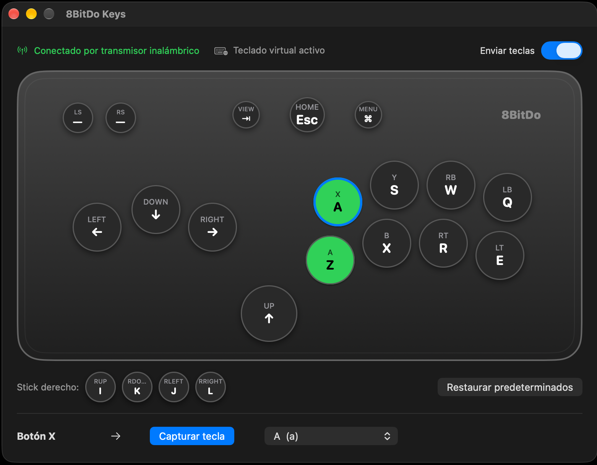

# 8BitDo Keys: a macOS driver for the 8BitDo Arcade Controller for Xbox

**English** | [Español](README_es.md)

A user-space macOS driver that makes the **[8BitDo Arcade Controller for Xbox](https://www.8bitdo.com/arcade-controller-xbox/)** usable on a Mac. It turns every button into a keyboard key that you choose, and it comes with a small native app that shows a drawing of the controller so you can remap keys visually.

It works with apps that read the keyboard directly from the hardware, such as **OpenEmu**, because the keys are emitted through a real virtual HID keyboard (provided by Karabiner-Elements), not just simulated key presses.

<p align="center">
  
</p>

> **Why this exists:** Xbox-licensed controllers do not speak standard USB HID. They use Microsoft's **GIP** protocol, and macOS only supports Microsoft's own controllers. This controller enumerates on the Mac, but no driver claims it and no game sees it. This project talks GIP directly over USB with libusb.

---

## Contents

- [Features](#features)
- [How it works](#how-it-works)
- [Compatibility](#compatibility)
- [Requirements](#requirements)
- [Installation](#installation)
- [Usage](#usage)
- [Using it with OpenEmu](#using-it-with-openemu)
- [Key map file](#key-map-file)
- [Troubleshooting](#troubleshooting)
- [Uninstalling](#uninstalling)
- [Project layout](#project-layout)
- [Limitations](#limitations)
- [License and credits](#license-and-credits)

---

## Features

- **No kernel extension**: runs entirely in user space with libusb.
- **Visual remapping app** (`8BitDo Keys.app`):
  - shows a drawing of the controller, and each button lights up when you press it;
  - click a button (or press it on the controller) and then press a key to assign it, or pick the key from a menu;
  - shows whether the controller is connected **by cable** or through the **2.4 GHz wireless adapter**;
  - shows whether keys go through the virtual keyboard or are simulated, and lets you pause key output.
- **Works with OpenEmu** and other apps that read the keyboard directly from the hardware, through the Karabiner virtual HID keyboard.
- **Falls back** to simulated keys (CGEvent) when the virtual keyboard is not available. These work in most apps, but not in OpenEmu.
- **Command-line tool** (`gip2key`) that uses the same key map as the app.
- **Diagnostic tool** (`probe`) that dumps the USB descriptors and the raw GIP packets.
- Reconnects automatically when the controller is unplugged and plugged in again.

## How it works

```
┌────────────────────┐   USB (GIP)   ┌─────────────────────┐  Unix socket  ┌──────────────────┐
│ 8BitDo Arcade      │ ────────────▶ │ 8BitDo Keys.app     │ ────────────▶ │ gip2key-relay    │
│ Controller / 2.4G  │               │  or gip2key (CLI)   │  key up/down  │ (root daemon)    │
│ wireless adapter   │ ◀──────────── │  libusb + GIP init  │               └────────┬─────────┘
└────────────────────┘  power on/ACK └──────────┬──────────┘                        │
                                                │ fallback: CGEvent                 ▼
                                                ▼                         Karabiner virtual
                                          normal apps                     HID keyboard
                                                                                    │
                                                                                    ▼
                                                                         every app, OpenEmu too
```

1. **The app (or the CLI)** opens the controller with libusb, sends the GIP *power on* command, answers the ACKs the controller asks for and decodes the input reports. See [docs/PROTOCOL.md](docs/PROTOCOL.md) for the details.
2. Each button change becomes a **key down / key up** event for the key you assigned to that button.
3. If the **relay** is running, the key goes to it through a Unix socket that only your user can write to. The relay runs as root, because Karabiner's virtual keyboard service only accepts root clients, and it posts the key to the **Karabiner virtual HID keyboard**. To macOS that keyboard is a real hardware keyboard.
4. If the relay is not running, the key is **simulated** with `CGEventPost`, which needs the Accessibility permission.

## Compatibility

| Item | Tested |
|---|---|
| Controller | 8BitDo Arcade Controller for Xbox (USB `2DC8:202C`) |
| Connection | USB-C cable, and the 8BitDo 2.4 GHz wireless adapter |
| Mac | Apple Silicon (arm64) |
| macOS | 27 |
| Karabiner-Elements | Bundles Karabiner-DriverKit-VirtualHIDDevice **1.8.0** (client library `v8.7.0`) |

Other Xbox GIP controllers will probably work if you change `VID` / `PID` in `src/core/gip_core.c`. Use `build/probe` to check what your device sends.

## Requirements

- macOS with **Xcode Command Line Tools** (`clang`, `swiftc`, `git`)
- **[Homebrew](https://brew.sh)**
- **libusb** and **pkgconf**, installed through Homebrew
- **[Karabiner-Elements](https://karabiner-elements.pqrs.org)**: needed for OpenEmu and similar apps (recommended)

---

## Installation

### 1. Install the build tools

```sh
xcode-select --install          # skip if already installed
brew install libusb pkgconf
```

### 2. Get the code and build it

```sh
git clone https://github.com/angelurueta/8bitdo-Arcade-Controller-on-Mac.git
cd 8bitdo-Arcade-Controller-on-Mac
make
```

`make` builds everything into `build/`:

| Output | What it is |
|---|---|
| `build/8BitDo Keys.app` | The visual app |
| `build/gip2key` | The command-line driver |
| `build/gip2key-relay` | The virtual keyboard relay daemon |
| `build/probe` | The USB/GIP diagnostic tool |

The first build downloads the Karabiner client library (header-only, public domain) into `vendor/`. libusb is linked statically, so the app does not depend on Homebrew at runtime.

### 3. Install Karabiner-Elements and approve its driver

This gives macOS a virtual HID keyboard. You only have to do it once.

```sh
brew install --cask karabiner-elements
```

1. Open **Karabiner-Elements** once.
2. Approve the driver extension. Go to **System Settings → General → Login Items & Extensions → Driver Extensions** and enable **Karabiner-DriverKit-VirtualHIDDevice**. On some macOS versions the prompt appears instead in **System Settings → Privacy & Security**, with an **Allow** button.
3. In **Login Items & Extensions → Allow in the Background**, make sure the Karabiner-Elements items are enabled.
4. Grant **Input Monitoring** to Karabiner if it asks.

Check that the extension is active:

```sh
systemextensionsctl list | grep pqrs
# ... org.pqrs.Karabiner-DriverKit-VirtualHIDDevice (1.8.0/1.8.0) ... [activated enabled]
```

> **Version matching:** the client library version must match the driver that Karabiner-Elements installed. The number in parentheses (`1.8.0` above) is the driver version. `v8.7.0` of [Karabiner-DriverKit-VirtualHIDDevice](https://github.com/pqrs-org/Karabiner-DriverKit-VirtualHIDDevice) ships driver `1.8.0`. If yours differs, find the tag whose `version.json` has your `driver_version`, set `KARABINER_TAG` in the `Makefile` to it, and rebuild with `make distclean && make`.

### 4. Install the relay daemon

```sh
make install-relay        # runs: sudo scripts/install-relay.sh
```

This installs `/usr/local/libexec/gip2key-relay` and the LaunchDaemon `/Library/LaunchDaemons/local.8bitdo.gip2key-relay.plist`. The daemon starts at boot and restarts if it stops. Its socket `/var/run/gip2key-relay.sock` belongs to your user, with mode `0600`.

Check the log:

```sh
tail -5 /var/log/gip2key-relay.log
# escuchando en /var/run/gip2key-relay.sock
# conectado al servicio de Karabiner
# teclado virtual listo
```

(The log and the app UI are currently in Spanish.)

### 5. Install the app

```sh
make install              # copies the app to /Applications
```

Open **8BitDo Keys** from `/Applications`. The status bar at the top should show:

- **Conectado por cable** / **Conectado por transmisor inalámbrico**: the controller is connected, by cable or through the wireless adapter.
- **Teclado virtual activo**: keys go through the Karabiner virtual keyboard.

> **Without the relay**, the app simulates keys and needs **Accessibility** permission: **System Settings → Privacy & Security → Accessibility → enable 8BitDo Keys**. The app is signed ad hoc, so macOS may ask for this permission again after every rebuild. With the relay running, Accessibility is not needed.

---

## Usage

### The app

- **Controller drawing**: each circle is a button, labeled with the button name (small) and its assigned key (large). A button turns **green** while you press it.
- **Remap a button**:
  1. Click the button in the drawing, or press it on the real controller while the app is in front.
  2. Click **Capturar tecla** ("capture key") and press the key you want. Modifiers (⇧ ⌃ ⌥ ⌘) work too.
  3. Or choose the key from the dropdown. Choose **— ninguna —** to disable the button.

  Changes are saved immediately.
- **Stick derecho** ("right stick") row: keys for the four right-stick directions, used when the controller's directional mode is set to RS.
- **Enviar teclas** ("send keys") switch: pauses key output while still showing button presses.
- **Restaurar predeterminados**: restores the default key map.
- **Configuración** ("configuration") row: saved key maps.
  - Pick one from the dropdown to apply it. A **Street Fighter** configuration is included (directions on WASD, punches on U I O Y, kicks on J K L H).
  - **Guardar como…** ("save as") saves the current keys under a name. Using an existing name replaces it.
  - **Eliminar** ("delete") removes the selected configuration after asking for confirmation.

  Configurations are stored as `.conf` files in `~/Library/Application Support/8BitDo Keys/Configuraciones/`, in the same format as the key map file.
- Closing the window quits the app. Keep it open (or minimized) while you play.

Only one program can use the controller at a time, so **don't run the app and `gip2key` together**.

### Command line

```sh
build/gip2key            # run the driver
build/gip2key -v         # also print each button press (useful to identify buttons)
build/gip2key -c my.conf # use a different key map file
```

By default `gip2key` uses the same key map as the app, `~/Library/Application Support/8BitDo Keys/keymap.conf`. If that file does not exist yet, it uses the defaults.

### Diagnostics

```sh
build/probe
```

It prints the USB interfaces and endpoints, sends *power on*, and then shows every GIP packet received for 20 seconds. Use it when adding support for another controller, or to report a problem.

---

## Using it with OpenEmu

1. Make sure the **relay** is installed and the app shows **Teclado virtual activo**.
2. Give OpenEmu **Input Monitoring** permission: **System Settings → Privacy & Security → Input Monitoring → OpenEmu**.
3. Open **OpenEmu → Settings → Controls**, choose a system, select **Keyboard** as the input device, then click each action and press the matching button on the controller.

OpenEmu reads keyboards through `IOHIDManager`, so it ignores simulated `CGEvent` keystrokes. That is why the relay and the Karabiner virtual keyboard are needed. Emulators that accept regular keystrokes (RetroArch, MAME, …) also work without the relay.

---

## Key map file

The app writes the key map to `~/Library/Application Support/8BitDo Keys/keymap.conf`. You can also edit it by hand. [config/keymap.example.conf](config/keymap.example.conf) contains the defaults.

```ini
# BUTTON = key      ("none" disables the button)
UP    = up
A     = z
MENU  = return
LS    = none
```

**Buttons:** `A B X Y LB RB LT RT MENU VIEW HOME LS RS UP DOWN LEFT RIGHT RUP RDOWN RLEFT RRIGHT`

**Keys:**

| Group | Names |
|---|---|
| Letters and digits | `a`–`z`, `0`–`9` |
| Arrows | `up down left right` |
| Special | `space return tab escape backspace capslock` |
| Modifiers | `shift control option command rshift rcontrol roption` |
| Punctuation | `minus equal leftbracket rightbracket backslash semicolon quote comma period slash grave` |
| Function keys | `f1`–`f12` |
| Any other macOS virtual key code | `kNN`, e.g. `k82` (simulated keys only; not sent through the relay) |

Aliases are also accepted: `enter`, `esc`, `alt`, `ctrl`, `cmd`, `ralt`, `rctrl`.

**Default map:**

| Controller | Key | Controller | Key |
|---|---|---|---|
| Up / Down / Left / Right | Arrow keys | Menu | Return |
| A / B / X / Y | Z / X / A / S | View | Tab |
| LB / RB / LT / RT | Q / W / E / R | Home | Escape |
| Right stick ↑ ↓ ← → | I / K / J / L | LS / RS | — |

---

## Troubleshooting

| Symptom | Cause / fix |
|---|---|
| App says **Control no detectado** | Check the cable or adapter with `ioreg -p IOUSB -w0 \| grep -i 8bitdo`. Make sure `gip2key` or `probe` is not running at the same time. |
| Buttons light up but no keys are typed | Without the relay: grant **Accessibility** to the app (again after a rebuild). With the relay: check the relay log. |
| Keys work in TextEdit but **not in OpenEmu** | The relay is not active. Install it (step 4) and give OpenEmu **Input Monitoring**. |
| Relay log: `no se pudo conectar a Karabiner: asio.system:2` | Karabiner's service socket does not exist yet. The driver extension is not approved (`systemextensionsctl list` shows `activated waiting for user`) or Karabiner-Elements is not running. Approve it (step 3). The relay retries automatically. |
| Relay log: `la versión del driver de Karabiner no coincide` | The client library does not match your Karabiner driver. See *Version matching* in step 3. |
| A button appears at the wrong place in the drawing | The layout is approximate. Run `build/gip2key -v` to see which name each button reports, and open an issue. |
| Connection shows **tipo desconocido** | Your unit's USB serial number doesn't match the observed pattern. Open an issue including the serial number (hover over the status). |

---

## Uninstalling

```sh
make uninstall-relay                       # removes the daemon and its LaunchDaemon
rm -rf "/Applications/8BitDo Keys.app"
rm -rf ~/Library/Application\ Support/8BitDo\ Keys
```

Karabiner-Elements can be removed from its own menu (**Uninstall Karabiner-Elements**) or with `brew uninstall --cask karabiner-elements`.

---

## Project layout

```
.
├── Makefile                    build, install and relay targets
├── src/
│   ├── core/gip_core.{c,h}     GIP over libusb, button decoding, key map, key output
│   ├── app/main.swift          SwiftUI app (8BitDo Keys)
│   ├── app/Info.plist
│   ├── cli/gip2key.c           command-line driver
│   ├── relay/gip2key-relay.cpp root daemon → Karabiner virtual HID keyboard
│   └── tools/probe.c           USB / GIP packet dumper
├── scripts/install-relay.sh    installs or uninstalls the LaunchDaemon
├── config/keymap.example.conf  default key map
└── docs/PROTOCOL.md            GIP protocol notes for this controller
```

`build/` and `vendor/` are generated and ignored by git.

## Limitations

- **Keyboard output only.** macOS restricts virtual gamepads to apps with an Apple-granted entitlement (`com.apple.developer.hid.virtual.device`), so the controller cannot appear as a gamepad to games.
- With the wireless adapter, the app cannot yet tell whether the controller itself is switched off: the adapter alone is reported as "connected".
- The controller drawing is an approximation of the leverless layout.
- The app's UI and log messages are in Spanish.
- Rumble, audio and the controller's own profile features are not supported.

## License and credits

- This project is released under the [MIT License](LICENSE).
- [libusb](https://libusb.info) is LGPL-2.1. The app links it statically. If you redistribute compiled binaries, keep the LGPL relinking obligations in mind.
- [Karabiner-DriverKit-VirtualHIDDevice](https://github.com/pqrs-org/Karabiner-DriverKit-VirtualHIDDevice) by Takayama Fumihiko is public domain and is downloaded at build time.
- The GIP protocol knowledge builds on the work of the Linux [`xpad`](https://github.com/torvalds/linux/blob/master/drivers/input/joystick/xpad.c) and [`xone`](https://github.com/medusalix/xone) drivers.
- Not affiliated with 8BitDo, Microsoft or the Karabiner project. "Xbox" is a trademark of Microsoft.
